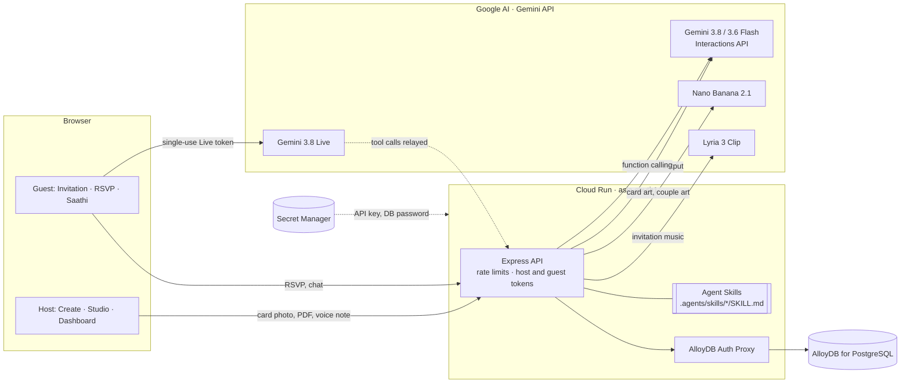

# Baraati Saathi

[](https://github.com/abhiinavkumarr/baraati-saathi-buildathon/actions/workflows/ci.yml)

**From a wedding card to a voice concierge in three minutes.** An AI layer for
Indian weddings, built for the Google DeepMind × Google Cloud Startup Buildathon
India 2026 by [Baraati](https://baraati.co.in), a wedding app live on iOS,
Android and the web. This repository is a new, separate product: it contains
no Baraati app code.

**Live:** https://baraati-saathi-570792946314.asia-south1.run.app
(demo invitation: [/i/riya-kabir-b4fc738a](https://baraati-saathi-570792946314.asia-south1.run.app/i/riya-kabir-b4fc738a);
host links are in the submission form, since they carry the host's secret token).

---

## The problem

An Indian wedding runs on a printed card, a WhatsApp forward and a family
phone tree. Running Baraati, we kept running into the same three problems:

1. **Setting up is work.** The details already exist on the printed card, but
   every app makes the family type them in again, ceremony by ceremony.
2. **Digital invitations are flat.** A PDF of the card says nothing about the
   region, the music or the family, and guests can't answer it.
3. **The host's phone never stops.** Hundreds of guests ask "Haldi kab hai?",
   "Pickup hai?", "Bachche aa sakte hain?", often grandparents who would rather
   speak Hindi than type. And the host can't answer simple questions about
   their own guest list ("who lands on the 12th and needs a pickup?") without
   reading every RSVP.

## What Saathi does

| Act | For | What happens |
|---|---|---|
| **1. Card → wedding** | Host | Upload a photo or PDF of the card, or describe the wedding by chat or a voice note, in English, Hindi or Hinglish. Gemini reads every ceremony, date and venue, suggests ceremonies from the family's tradition, and asks only for what's missing. No card? Saathi builds one from the conversation. |
| **2. An invitation that moves** | Host → guests | Nano Banana paints card art in a regional style (Rajasthani, South Indian temple, Bengali alpana, Punjabi phulkari…), **a scene for every ceremony** (turmeric and marigolds for Haldi, henna for Mehendi, the sacred fire for the Pheras) and, optionally, a couple illustration from a photo; Lyria composes the music. Guests open one link in any browser, no install: doors swing open on the art, petals fall, a countdown runs, each ceremony has directions and *Add to calendar*. A personal link greets the guest by name. They RSVP in their own words ("coming with mom, landing 6 pm on the 12th, need pickup") and Gemini turns the note into arrival time, pickup, children and dietary needs. |
| **3. Saathi, by voice** | Guests | Guests ask by text or by voice (Gemini Live) in Hindi or English and get answers from this wedding's own data. Saathi can change the guest's own RSVP after confirming, and sends anything it can't answer to the host. When the host replies, the answer becomes an info card every guest's Saathi now knows. |
| **4. The host's AI control room** | Host | The host types or **speaks** in Hindi or English: *"Haldi ko 12 baje kar do aur sabko bata do"*. A Gemini agent with function calling checks the guest list (AlloyDB), then **proposes** a schedule change and an English + Hindi announcement as cards. Nothing changes until the host taps Publish; then the update appears on the invitation, Saathi knows it, and the host gets a personalised WhatsApp message per guest. Questions like *"Kitne log Jain khana khayenge?"* are answered by Gemini-written SQL in a locked-down AlloyDB sandbox, with the table and query shown. A morning **briefing** spots what matters (three guests landing within 20 minutes can share one cab), next to live charts of arrivals and food needs. |

## Architecture



* **One server, four agents.** The intake agent, the card designer, the guest
  concierge and the host's control room each load their instructions from an
  Agent Skill (`.agents/skills/`), the
  same format Antigravity reads. The server lists skills by name and
  description and loads a skill's full body only when an agent needs it.
* **The host's agent proposes; the host decides.** The control-room agent's
  tools (`query_guests`, `propose_event_change`, `propose_announcement`,
  `propose_info_card`, `propose_question_answer`) only create cards. A
  separate, host-authenticated `/apply` call makes the change.
* **Tools run on the server, always.** Saathi's four tools
  (`get_wedding_details`, `get_my_rsvp`, `update_rsvp`, `ask_host`) take the
  wedding and guest from the request, never from the model's arguments. Voice
  runs browser ↔ Gemini Live directly for low latency (16 kHz mic in, 24 kHz
  speech out), but every tool call is relayed back to the server to execute.
* **Generated media in the database.** Card art, illustrations and music are
  stored in AlloyDB (`bytea`) to keep the prototype to one dependency; Cloud
  Storage is the next step.
* **Demo-day resilience.** Every Gemini call has a model fallback chain, a
  retry on overload and an HTTP timeout. If AlloyDB is unreachable the server
  falls back to an embedded PGlite database and `/api/health` says so.

## Google AI and Google Cloud, in depth

| Piece | How it's used |
|---|---|
| **Gemini 3.8 Flash** (Interactions API, `v1beta`) | Multimodal intake: card images, PDFs and voice notes go in as typed parts; the reply is **structured output** against a JSON Schema of the whole wedding (`server/wedding.ts`), with thinking level `low` for speed. Also writes the guest-list SQL, and extracts logistics from RSVP notes, resolving "12 tareekh" against the wedding's schedule. |
| **Gemini 3.6 Flash** | Saathi's text chat (fastest first, `thinking_level: minimal`) with **function calling** over 4 tools and up to 5 tool hops. The wedding's public details are pre-fetched into the system prompt, so most answers take one call. |
| **Gemini 4 "Hydrogen"** | Last link in the text fallback chain. |
| **Gemini 3.8 Live** | Real-time voice. The server mints a **single-use ephemeral token** whose model, system instruction and tools are locked (`liveConnectConstraints`), so the browser can't repurpose it. Input and output transcription give captions; barge-in (`interrupted`) stops playback. |
| **Nano Banana 2.1** | Card background art (9:16, regional motif table in the `card-designer` skill, no text in the art so typography stays editable) and a couple illustration from a photo (image + text input). Falls back to Gemini 3.1 Flash Image. |
| **Lyria 3 Clip** | A 30-second instrumental theme per style: shehnai and dholak for Rajasthani, nadaswaram for South Indian, and so on. |
| **AlloyDB for PostgreSQL** | System of record (weddings, RSVPs, questions, media) and the engine for **Ask your guest list**, reached through the Auth Proxy bundled in the container. |
| **Cloud Run** | Hosting: one container with the API, the web app and the Auth Proxy. |
| **Secret Manager** | Gemini API key and database password; nothing secret in env files or images. |
| **Agent Skills** | `wedding-intake`, `card-designer`, `saathi-concierge`, `host-control-room`, `guest-data-guardrails`. |
| **Antigravity** | Development IDE, with the Google Cloud Data Agent Kit plugin. |

## Ask your guest list: model-written SQL, safely

Letting a model write SQL over a guest list needs more than a prompt. In
`server/insights.ts` the generated query passes five independent layers:

1. **Static check.** A single `SELECT`/`WITH`, no comments, no `;`, no system
   catalogs, no real table names. A rejected query goes back to the model once,
   with the reason.
2. **Rolled-back transaction.** The query runs inside `BEGIN … ROLLBACK`, so
   nothing it does is kept.
3. **A role with no privileges.** `SET LOCAL ROLE saathi_reader`, a role
   granted nothing on any real table. If the role switch fails, the query is
   not run.
4. **Only this wedding's rows.** Before switching role, the server copies the
   wedding's RSVPs into a temporary `guests` table (phone numbers left out) and
   its schedule into `events`. The model only ever knows those two tables.
5. **Limits.** A 4-second statement timeout and a 200-row cap.

`tests/insights.test.ts` checks this: another wedding's guests are never
counted, `SELECT phone` fails, and `SELECT … FROM public.rsvps` gets
*permission denied* even with the static check bypassed.

## Privacy and security

* Guest-data rules are written once, in `.agents/skills/guest-data-guardrails/`,
  and loaded into every agent that touches guest data.
* The host's studio and dashboard need a 144-bit host token. Guests get their
  own token when they RSVP and can only read or change their own answer.
* The host sees phone numbers masked (`••••3210`); the model never sees them.
* Uploads are type-checked and size-capped, and every API route is
  rate-limited per IP.
* No face recognition and no government IDs (India's DPDP Act).

## Accessibility

Built for grandparents as much as for the couple:

* Voice in Hindi and English, with every spoken reply also shown as text.
* **0 axe-core violations (WCAG 2.1 A/AA)** on every page state: create,
  invitation (closed, open, RSVP), Saathi, studio and dashboard.
* Labelled controls, chat logs announced to screen readers (`role="log"`),
  a visible focus ring, Escape to close Saathi with focus returned, and all
  motion turned off under `prefers-reduced-motion`.
* Works in any mobile browser with no install; guests never create an account.

## Tests and CI

```bash
npm test          # 27 tests on in-memory PGlite; no API key needed
npm run typecheck
```

* `tests/insights.test.ts`: sandbox isolation, rollback, role, SQL static check.
* `tests/saathi-tools.test.ts`: tools only touch the caller's own RSVP and
  wedding, ignore injected ids, and never return phone numbers or host tokens.
* `tests/control.test.ts`: the control room's numbers (headcounts, pickups,
  food needs per household, arrivals) come from code, not the model.
* `tests/wedding.test.ts`: draft normalisation (bad model output becomes
  "unknown", never a guess), the readiness rule, slugs and tokens, Agent Skill parsing.
* Live checks against a running server with real Gemini calls:
  `scripts/smoke.ts` (every flow, PASS/FAIL), `scripts/agent-test.ts` (control
  room in Hinglish), `scripts/e2e.ts` (the whole flow), `scripts/ask-test.ts` (guest-list
  questions plus a prompt-injection attempt), `scripts/live-test.ts` (Gemini Live voice).

GitHub Actions runs typecheck, tests and the production build on every push.

## Run locally

```bash
cp .env.example .env      # add GEMINI_API_KEY (paid tier for Nano Banana and Lyria)
npm install
npm run dev               # API on :8080 with a local PGlite database in .data/
npm run dev:web           # web on :5173, proxies /api
```

Set `DATABASE_URL` to use AlloyDB or any PostgreSQL instead of PGlite.

## Deploy to Cloud Run

The Dockerfile builds the web app and bundles the AlloyDB Auth Proxy.

```bash
printf '%s' "$GEMINI_API_KEY" | gcloud secrets create gemini-api-key --data-file=-

gcloud run deploy baraati-saathi --source . --region asia-south1 \
  --allow-unauthenticated --min-instances 1 --max-instances 1 --memory 1Gi \
  --set-secrets GEMINI_API_KEY=gemini-api-key:latest,DB_PASSWORD=alloydb-password:latest \
  --set-env-vars ALLOYDB_INSTANCE_URI=projects/P/locations/R/clusters/C/instances/I,ALLOYDB_PROXY_FLAGS=--public-ip,DB_USER=postgres,DB_NAME=postgres

node --import tsx scripts/seed-demo.ts https://<service-url>   # demo wedding + its links
```

## Repository map

```
server/          Express API
  intake.ts        Act 1: card / chat / voice note → structured wedding
  design.ts        Act 2: art, music, RSVP + note extraction, host dashboard
  saathi.ts        Act 3: chat with function calling, Live tokens, tool relay
  insights.ts      Guest-list questions (text-to-SQL sandbox)
  control.ts       Host control room: agent, confirm-to-apply, briefing
  gemini.ts        Interactions API wrapper, fallback chains
  db.ts            AlloyDB (pg) or PGlite, plus the rollback sandbox
  skills.ts        Agent Skills loader
web/src/         React app: Create, Studio, Invite, Host, Saathi, live.ts (voice)
.agents/skills/  Agent Skills (SKILL.md)
db/schema.sql    Tables and the saathi_reader role
tests/           node:test suites
scripts/         Seed, end-to-end and live checks
```

## What's next

* Move RSVP-note extraction into the database with AlloyDB AI (`AI.EXTRACT`),
  and add vector search over info cards as weddings grow.
* Media to Cloud Storage; rate limits to a shared store when scaling out.
* Bring Saathi into the Baraati app for its live weddings.
